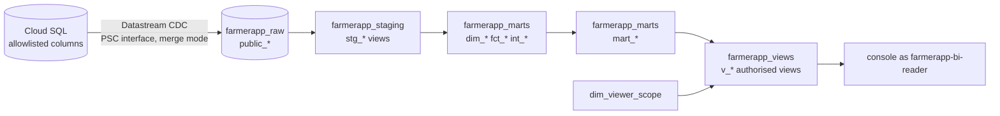

# dbt/ — FarmerApp analytics (SPEC 5)

Datastream replicates Cloud SQL into BigQuery; dbt turns the replica into governed marts that
the console dashboards, Looker Studio and the validation agents read (SPEC 5 flowchart). For P0
the console still reads the API's Postgres replica (SPEC 5.3); wiring dashboards to
`farmerapp_views` is a later M7 task.



## Run it

| Command | What |
|---|---|
| `make dbt` | `dbt build --target ci`: DuckDB over the fixture seeds, every model and test. No GCP, no credentials. |
| `make check-dbt` | Part of `make check`: replication allowlist check + `make dbt` (skips when `uv` is missing). |
| `make dbt-dev` | `dbt build --target dev` on BigQuery `farmerapp-dev` (ADC; `DBT_IMPERSONATE_SA=farmerapp-dbt@farmerapp-dev.iam.gserviceaccount.com` to run as the dbt SA). Needs the dev stream running. |
| `make dbt-freshness` | AN-010 `dbt source freshness --target dev`. |

By hand: `cd dbt && uv sync && DBT_PROFILES_DIR=. uv run dbt build --target ci`. Versions are
pinned in `pyproject.toml` / `uv.lock` (dbt-core 1.11, dbt-duckdb, dbt-bigquery). No dbt packages:
`dbt deps` is never needed (generic tests live in `macros/tests/`).

Targets (`profiles.yml`): `ci` (DuckDB file `target/ci.duckdb`), `dev` / `stg` / `prd` (BigQuery,
OAuth / WIF, optional impersonation, `maximum_bytes_billed` guard). `macros/schema.sql` maps the
custom schemas to the Terraform-owned datasets `farmerapp_{raw,staging,marts,views}` on every
target. The fixture seeds are enabled **only** on `ci` (on BigQuery `farmerapp_raw` belongs to
Datastream).

## Portability (one SQL, two engines)

Models are plain SQL plus the dispatch macros in `macros/portable.sql` (`ist_date`, `add_days`,
`week_start`, `month_end`, `date_series`, `json_text`, `seconds_between`, `safe_ratio`, `paise`,
`row_key`, `bq_date_partition`), each with a `default__` (DuckDB) and a `bigquery__`
implementation. `macros/raw.sql` reads `source('farmerapp_raw', 'public_<t>')` on BigQuery and the
seed `public_<t>` on `ci`, packing the seed's `_ds_uuid` / `_ds_source_timestamp` into the same
`datastream_metadata` STRUCT Datastream writes. Compiled BigQuery SQL was checked with
`dbt compile --target dev` (offline, `--no-populate-cache --no-introspect`) and a BigQuery-dialect
parse of all compiled files.

## Models

**Staging** (`models/staging`, views): one per replicated table. Latest CDC row per primary key
(`latest_cdc_rows`: highest `source_timestamp`), soft deletes removed (`deleted_at is null`;
products, SKUs and stock batches keep `is_deleted` because old sales still need them), typed
(ids as strings, money as integer paise, UTC timestamps plus IST dates), `tenant_id` on every
row, **PII dropped or masked** (AN-014): no names, no phones (`phone_masked` = 9 stars + the last
4 digits, as the console shows it without PII access), no landmarks, points, notes, token hashes.
`stg_app_session` is `refresh_token` restricted to farmer logins (the API's app-session proxy).

**Core** (`models/marts/core`, tables): `dim_store`, `dim_employee` (ids, role, store, cluster),
`dim_viewer_scope` (AN-013 mapping), `fct_sales_line` (fulfilled order lines: net after the
pro-rata order discount, cost from the sold batch else the store's average batch cost),
`fct_visit` (verified, confirmed, time on farm, 30-day conversion), `int_flag_officer`.

**Marts** — SPEC 5.2 definitions, mirroring `apps/api/farmerapp/analytics/kpi.py` (and
`khata/aging.py`, `analytics/stores.py`, `analytics/field_team.py`):

| Mart | Dashboard | Grain | KPIs |
|---|---|---|---|
| `mart_owner_kpi_30d` | AN-001 | tenant, last 30 IST days | net sales, own-brand share, gross margin, verified visits, unique farmers reached, confirmation rate, visit conversion, time on farm, active farmers, credit outstanding / overdue, open flags |
| `mart_active_farmers_daily` | AN-001 | tenant x day (90 days) | active farmers (purchase, verified visit or app session in day-59..day) |
| `mart_store_daily` | AN-001 / 005 | store x IST day | gross, discount, net, own-brand net / share, COGS, margin, write-offs, contribution, day-close variance |
| `mart_officer_daily` | AN-002 | officer x day | visits, verified, confirmed, farmers visited / reached, time on farm, duty, km, registrations, collections |
| `mart_officer_scorecard_30d` | AN-002 | active field officer | verified / duty day, reached, registrations, confirmation, avg time on farm, km / duty day, conversion, collections, open flags, rank |
| `mart_farmer_360` | AN-004 | farmer | acreage, current crop / stage, last visit / purchase / app session, lifetime net, **LTV** (cumulative gross margin), credit, credit risk, active, segment, churn risk |
| `mart_farmer_segments` | AN-004 | district x crop x stage x segment | farmers, acreage |
| `mart_credit_accounts` | AN-005 | farmer x store khata | outstanding, overdue, buckets 0-30 / 31-60 / 61-90 / 90+ (FIFO by due date), credit risk |
| `mart_store_snapshot` | AN-005 | store | stock value, stockouts, COGS 30 d, stock turns (and annualised), credit book, last day close |
| `mart_store_category_monthly` | AN-005 | store x month x category x brand | net, COGS, margin, margin % |
| `mart_crop_health_weekly` | AN-006 | district x crop x problem x ISO week | confirmed cases, farmers, prior-4-week average, outbreak alert |
| `mart_diagnosis_quality_weekly` | AN-007 | tenant x ISO week | corpus share, escalation rate, review SLA (24 h), avg review hours; `test_set_accuracy` NULL until DX-011 results are published |
| `mart_diagnosis_unknowns` | AN-007 | week x crop x reason | out-of-scope cases (top unknowns) |
| `mart_campaign_roi` | AN-008 | campaign x channel x week | **placeholder with no rows until WC-008** |
| `mart_flags_weekly` | AN-009 | rule x ISO week | raised, high, open, resolved, avg resolution hours, true / false positives |
| `mart_flag_repeat_offenders` | AN-009 | officer (>= 2 flags / 90 d) | flags, open, rules |

Working definitions that SPEC 5 names but does not define (change them here and in the SPEC
together): segment (`new` / `active_buyer` / `engaged` / `lapsed` / `dormant`), churn risk (days
since the last activity: <= 30 low, 31-60 medium, > 60 high), outbreak (>= 3 cases and >= 2x the
prior 4-week average), repeat offender (>= 2 flags in 90 days).

Snapshot marts are computed **as of** an IST date: `--vars '{as_of: 2026-09-15}'`, else today in
IST; `ci` pins the fixture date 2026-09-15.

## Tests

* **AN-012**: every mart has `unique` + `not_null` on its key (composite grains get a `row_key`
  column), `relationships` on its foreign keys and `accepted_values` on its categorical or
  definition columns (`_marts.yml`); staging keys are tested too (`_staging.yml`).
* **KPI reconciliation** (`tests/fixture_*.sql`, `ci` only): each mart compared row by row with
  values computed by hand from `seeds/raw` (the arithmetic is in each test's header). They cover
  CDC dedup (older versions of an order, a visit, a user, a tenant), soft deletes, the IST day
  boundary, pro-rata discounts, average-cost fallback, FIFO ageing with harvest-month and
  tenant-default due dates, the 60-day active window and 30-day conversion window.
* **AN-013**: `tests/an013_row_scopes_hold.sql` (every target, real data included) fails on any
  view row outside its viewer's tenant, cluster, store or role; `tests/fixture_an013_viewer_mapping.sql`
  pins exactly which stores each fixture viewer sees.
* **AN-014**: `tests/an014_no_pii_in_marts_and_views.sql` inspects the columns of every built
  staging / mart / view relation; `phone_masked` is checked for shape; `scripts/check_replication.py`
  keeps the Datastream allowlist (`infra/modules/analytics/replicated_columns.json`), the sources
  and the fixtures identical and PII-free.
* **AN-010**: sources `public_order`, `public_payment`, `public_visit`, `public_duty_session` have
  `freshness` warn 15 min / error 30 min on `datastream_metadata.source_timestamp`
  (`dbt source freshness` on BigQuery); `tests/an010_source_freshness_contract.sql` keeps the
  contract on every target.

## Row-level security (AN-013): how the console reads

The console never reads `farmerapp_marts`. It impersonates `farmerapp-bi-reader`, which can read
only `farmerapp_views`; that dataset is authorised on `farmerapp_marts` (Terraform). Because all
FarmerApp users share that one service account, BigQuery row access policies and
`SESSION_USER()` cannot tell them apart, so each `v_*` view joins its mart to `dim_viewer_scope`
and returns **one row per (viewer_user_id, row the viewer may see)**:

| Role | Scope |
|---|---|
| owner, director, tenant_admin, auditor | every row of their tenant |
| agronomist | tenant, crop-health and diagnosis views only |
| cluster_head | rows whose `cluster_id` is their cluster (only own cluster) |
| store_manager | rows whose `store_id` is their store (store views only) |
| anyone else, disabled or deleted users | nothing |

The console passes the **signed-in user's id from its verified session** as a query parameter,
the same trust the API has when it binds `app.tenant_id` for Postgres RLS:

```sql
SELECT * FROM `farmerapp-dev.farmerapp_views.v_store_daily`
WHERE viewer_user_id = @viewer_user_id AND date_day BETWEEN @from AND @to
```

A query without the `viewer_user_id` filter returns the rows of every viewer: the console's
BigQuery client must add it on every query (to be enforced in the console wiring task).

## Add a mart

1. Write `models/marts/<area>/mart_<name>.sql` on top of staging / core models only; use the
   macros for anything dialect-specific; add `partition_by=bq_date_partition('<date col>')` for
   daily / weekly grains; carry `tenant_id` (and `cluster_id`, `store_id` when rows belong to a
   store) so it can get an authorised view.
2. Declare it in `models/marts/_marts.yml` with `unique` + `not_null` on its key (add a
   `row_key([...])` column for a composite grain), `relationships` and `accepted_values` (AN-012).
3. Add fixture rows to `seeds/raw` if needed (then `uv run python scripts/gen_seed_types.py`) and a
   `tests/fixture_<name>_reconciles.sql` with hand-computed expectations.
4. Add `models/views/v_<name>.sql` (`{{ authorised_view('mart_<name>', grain=..., scoped_roles=[...]) }}`),
   list it in `models/views/_views.yml`, `tests/an013_row_scopes_hold.sql` and the `depends_on`
   refs of `tests/an014_no_pii_in_marts_and_views.sql`.
5. `make dbt`.

## Replicate a new table or column

Add it to `infra/modules/analytics/replicated_columns.json` **and** `models/staging/_sources.yml`
(and the seed header), never a PII column; `scripts/check_replication.py` fails otherwise. After
the Terraform apply, re-run `python3 infra/scripts/datastream_sql.py --part owner` on the
instance (grants, policy, publication: `docs/runbooks/datastream-cdc-setup.md`).
